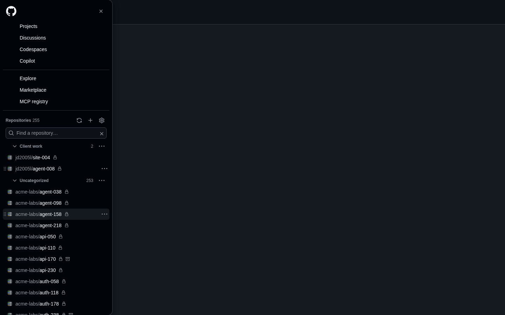

<p align="center"></p>

<h1 align="center">GitHub Repo Navigator</h1>

<p align="center"><strong>Every repository you can access, organized, right in GitHub's menu.</strong><br>
A Chrome extension that replaces GitHub's short "Top repositories" lists with your complete list, grouped into your
own sections that sync between your Chrome devices. Read-only, with no server.</p>

<p align="center">
<a href="https://jd2005l.github.io/GitHubRepoNavigator/">Website</a> ·
<a href="#install">Install</a> ·
<a href="PRIVACY.md">Privacy</a> ·
<a href="https://github.com/sponsors/JD2005L">Sponsor</a>
</p>



GitHub shows about ten "top" repositories and hides the rest behind *Show more*. If you work across many
repositories, clients or organizations, finding the one you want means searching every time. Repo Navigator puts
your complete list, grouped the way you think about it, exactly where GitHub's short list used to be.

It changes exactly two places, both called **Top repositories** on GitHub: the side menu behind the ☰ button
(top-left of any github.com page) and the left sidebar of the github.com dashboard. Nothing else on GitHub changes.
If GitHub changes its page layout in a way the extension does not recognise, it steps aside and GitHub's own list
stays in place.

## Features

- **Complete list.** Every repository your authorization can reach, read from GitHub's official REST API page by
  page: your own, your organizations', and ones you collaborate on. It never scrapes GitHub's visible list.
- **Your sections.** Create, rename, reorder, collapse and delete sections. Drag repositories between and within
  sections, or move them with the keyboard. New repositories appear in **Uncategorized** automatically.
- **Organize automatically.** *Suggest sections* proposes sections (name-prefix families, other owners, websites,
  AI and agents, homelab, tools, apps, forks, an archive), shows an editable preview, and can be undone.
- **Back up and share.** Export your sections to a file and import them on another browser profile or account.
- **Fast filter** across the whole list, from either place.
- **Synced.** Sections travel through Chrome Sync, keyed by GitHub's immutable repository IDs, so renamed or
  transferred repositories keep their place.
- **More than one GitHub account.** Each github.com page shows the repositories and sections of the account it is
  signed in as, so GitHub's account switcher switches the list too.
- **Guided setup.** A checklist on the settings page verifies each step against what the extension can see.
- **Read-only and private.** Read-only repository metadata, no server, nothing sent anywhere but GitHub.
- **Accessible.** Full keyboard support, screen reader announcements for moves, and every GitHub theme.

## Install

**Chrome Web Store:** coming soon. Website: <https://jd2005l.github.io/GitHubRepoNavigator/>.

**From source (unpacked):** requires Chrome 140 or newer, Node.js 22.22.2+ (or 24.15+) and npm.

```bash
npm ci
npm run build          # writes the unpacked extension to dist/
```

1. Open `chrome://extensions` and turn on **Developer mode**.
2. Click **Load unpacked** and choose the `dist/` folder.
3. Click the extension's toolbar icon to open its settings page, which starts the guided setup.

The unpacked build's extension ID is pinned by the public key in `config/extension-public-key.txt`, so every
machine that loads it gets the same ID, **`pflbgfhcmioinmkjlhamdaijckgcdldf`**, and Chrome Sync can share sections
between them. (The matching private key was never kept: unpacked loading does not need it.) The Chrome Web Store
build has its own ID, so a store install and an unpacked install do not share synced sections; use *Export
sections* and *Import sections* to move them.

## Setup (about three minutes, once)

The settings page walks you through this on its *Setup* tab, with a checklist that verifies each step:

1. **Create your GitHub App.** The extension signs in through a small GitHub App that you own, limited to
   read-only repository metadata. The guide opens GitHub's *New GitHub App* form with everything pre-filled
   except **Enable Device Flow** (GitHub does not allow pre-filling that one), tells you where that checkbox is, and
   asks you to paste the app's **Client ID** back.
2. **Connect this browser.** Click *Connect GitHub*, enter the short code it shows on github.com, and click
   *Authorize*.
3. **Let the app see your repositories.** Install the app on your account with **All repositories**. Until it is
   installed, GitHub only lets it see your public repositories; the guide links straight to the install page and
   checks again when you come back.
4. **Open GitHub.** Open the ☰ menu or the dashboard. The first time, it asks *How do you want to start?*:
   *Suggest sections* (preview, then apply or undo) or *Start with one list*.

Repositories owned by organizations or other people appear once the app is installed on that account too; the
guide gives you an install link to send to an account's owner. On a second browser with Chrome Sync, the client ID
and sections are already there, so setup starts at *Connect GitHub*.

<details>
<summary>Manual GitHub App settings (if you prefer to create it by hand)</summary>

1. GitHub → **Settings → Developer settings → GitHub Apps → New GitHub App** (or an organization's settings, if
   the organization should own it).
2. **GitHub App name**: anything unique, e.g. `Repo Navigator (yourname)`. **Homepage URL**:
   `https://jd2005l.github.io/GitHubRepoNavigator/`, or any URL you own.
3. **Callback URL**: leave empty. Uncheck **Request user authorization (OAuth) during installation**.
4. **Enable Device Flow**: checked (required).
5. **Expire user authorization tokens**: leave checked (the extension renews tokens itself).
6. **Webhook**: uncheck **Active** (there is no server).
7. **Permissions → Repository permissions → Metadata: Read-only**, and **nothing else**. No organization or
   account permissions.
8. **Where can this GitHub App be installed?** **Any account**, if you want it on organizations or accounts you do
   not own. A private app can only be installed inside the account that owns it.
9. Create the app and copy its **Client ID** (it starts with `Iv`). Do **not** generate a client secret or a private
   key; the extension never uses them.
10. **Install** the app (the app's page → *Install App*) on your account and every organization whose repositories
    you want listed, with **All repositories**.

Give the client ID to the extension on the settings page (*Save client ID*), or bake it into a build:
`GRN_GITHUB_CLIENT_ID=Iv23li… GRN_GITHUB_APP_SLUG=your-app-slug npm run build`, or copy
`config/extension.config.example.json` to `config/extension.config.json` (git-ignored) and fill it in.
</details>

> **Why a GitHub App with the device flow?** A GitHub App can be limited to read-only repository metadata, which
> an OAuth App cannot do for private repositories (its `repo` scope grants write access). The device flow needs no
> client secret, and its tokens can be refreshed without one, so the extension needs no backend. The settings page
> tells you to enter only codes it showed you.

## Using it

| Action | Mouse | Keyboard |
|---|---|---|
| Filter | Type in *Find a repository…* | ↓ moves into results, Enter opens the first match, Esc clears |
| New section | ＋ in the header, or a repository's ⋯ → *New section…* | |
| Rename, delete or reorder a section | ⋯ next to the section | F2 renames, Delete deletes (empty only), Alt+↑/↓ moves |
| Collapse or expand | Click the section name | ← / → on the section name |
| Move a repository | Drag the row (touch: drag the ⋮⋮ grip) | Alt+↑/↓ (crosses into neighbouring sections), or ⋯ → *Move to section* |
| Move between rows | | ↑/↓, Home/End |

**Uncategorized** holds every repository that is not in a section, sorted by owner/name. A section can only be
deleted when it is empty everywhere (including repositories placed on another device).

**Suggest sections** (first run, or Settings → *Organize*) places only repositories that are still uncategorized.
Each goes to the first rule that claims it:

1. Archived on GitHub → **Archive** (listed last, starts collapsed).
2. Owned by another account → a section named after that account.
3. Three or more repositories sharing a name prefix → a section named after it (`AcmeAuth`, `AcmeBilling`,
   `AcmeDocs` → **Acme**). Short common words like "Pro" or "My" do not count; acronyms do.
4. Keywords in the name, description, topics and language → **Websites**, **AI & agents**, **Homelab &
   infrastructure**, **Tools & utilities**, **Apps & portals**.
5. Forks nobody else claimed → **Forks**.

Anything without a clear signal stays in Uncategorized. Nothing changes until you click *Create*, and *Undo* puts
everything back. Descriptions, languages and topics are read once for the preview and never stored or synced.

**Export sections / Import sections…** (Settings → *Organize*) write and read a JSON file of your sections with each
repository's ID and `owner/name`. Import matches by ID, then by `owner/name`, shows what it will do first, merges
sections with the same name, and can be undone.

## Chrome Sync

- **Synced** (`chrome.storage.sync`): section IDs, names, order, collapsed state and the ordered repository IDs in
  each, plus the GitHub App's client ID (a public identifier) and whether the first-run question was answered.
  1,000 placed repositories take about 7 KB of Chrome's 100 KB sync quota. Each GitHub account has its own sections.
- **This device only** (`chrome.storage.local`, which content scripts cannot read): per account, the repository
  cache, ETags, refresh metadata, the GitHub tokens and the sign-in identity.
- **Requirements**: Chrome signed in with sync on, the **Extensions** sync toggle on, and the same extension ID on
  each device. Each device connects to GitHub separately; tokens are never synced.
- A repository placed on one device but not visible on another is kept, not dropped. Edits are saved locally first,
  then written to Chrome Sync in batches; simultaneous edits on two devices are merged. If a newer version writes an
  incompatible format, older versions show it read-only instead of overwriting it.

## Privacy and permissions

| Permission | Why |
|---|---|
| `storage` | Sections (synced), the repository cache and tokens (this device only). |
| `alarms` | Periodic background refresh, and resuming sign-in if Chrome suspends the service worker. |
| `https://github.com/*` | Show the navigator in GitHub's ☰ menu and dashboard sidebar, and call GitHub's sign-in endpoints (`/login/device/code`, `/login/oauth/access_token`). |
| `https://api.github.com/*` | Read the repository list (`/user`, `/user/repos`, `/user/installations`, `/user/installations/{id}/repositories`) and, for *Find my app*, `/apps/{slug}`. |

- GitHub access is **read-only repository metadata**. The extension cannot change anything on GitHub.
- Per repository it keeps only ID, owner, name, owner avatar URL, visibility, archived/fork flags and last push time.
- There is no server: it talks only to GitHub, and sends nothing to the developer or anyone else. Tokens never
  appear in synced storage, logs or error messages, and never reach the content script.
- It does not use GitHub's internal endpoints, cookies, or the page's own repository list. No other extension or web
  page can message it.

Full policy: [PRIVACY.md](PRIVACY.md) (also published at <https://levac.net/repo-navigator/privacy.html>, the
address the Chrome Web Store listing uses).

## Troubleshooting

| Symptom | What to do |
|---|---|
| Nothing looks different on GitHub | The list is inside the **☰ menu** (top-left button) and on the **dashboard's left sidebar**. Other pages are unchanged by design. |
| GitHub's list with a small Repo Navigator card above it | Setup is not finished, or the list is still loading. The card says which; click it to open settings. |
| *Only public repositories are showing* | The GitHub App is not installed on your account yet. Click *Finish setup*, install it with **All repositories**, and come back. |
| *Some accounts only share selected repositories* | Change that installation to **All repositories** (settings → *Change repository access*). |
| GitHub's list and no card | GitHub changed its layout and the extension stepped aside, or the extension was updated after the tab was opened: reload the page. Also check that site access for github.com is allowed. |
| Organization repositories are missing | Install the app on that organization with All repositories, or ask an owner. For SAML organizations, sign in to the organization, then disconnect and reconnect. |
| *Rate limit reached* | GitHub's hourly API limit is used up. The saved list stays usable and refreshes after the time shown. |
| *Authorization expired* | Settings → **Setup** → **Reconnect GitHub**. Your saved list stays visible until then. |
| Sections do not reach another device | Check Chrome Sync (Extensions toggle) and that both devices show the same extension ID. A store install and an unpacked install differ: use Export / Import. |
| *Device flow is not enabled* or *client ID not recognised* | The settings page shows exactly what to check in your GitHub App, with a link to it. |

**Remove or reset:** *Disconnect this device* (Setup tab) deletes the tokens and cached list on this device.
*Revoke on GitHub* (<https://github.com/settings/apps/authorizations>) invalidates the tokens everywhere. *Reset
sections* (Repositories & sync tab) clears the synced layout on every device. Uninstalling makes Chrome delete local
data; reset sections first if you want the synced copy gone too.

## Development

```bash
npm ci
npx playwright install chromium   # once, for the browser tests (Linux CI: --with-deps chromium)
npm run typecheck      # TypeScript (strict)
npm run lint           # ESLint (bans HTML-string APIs and eval)
npm test               # Vitest: unit (node) and component (jsdom) tests
npm run build          # dist/ (production, unpacked)
npm run test:e2e       # builds dist-e2e/ and runs Playwright with the unpacked extension in Chromium
npm run check          # all of the above
npm run package        # Chrome Web Store submission folder: release/chrome-web-store-<version>/
```

TypeScript, esbuild, Vitest with jsdom, Playwright and ESLint. No runtime dependencies: the UI is a small DOM
builder (text nodes only) inside a Shadow DOM, and drag and drop is a pointer-events controller.

| Path | What is there |
|---|---|
| `src/background/` | Service worker: device-flow auth, GitHub client, inventory, suggestion hints, sync writer |
| `src/content/` | Detecting the ☰ menu and dashboard sidebar, mounting, the navigator UI |
| `src/options/` | Settings page and guided setup |
| `src/shared/` | Layout model, sync codec, migrations, suggestions, import/export, messages |
| `tests/` | Unit and component tests, HTML fixtures of GitHub's menu and dashboard, a mock GitHub API |
| `e2e/` | Playwright tests that load `dist-e2e/` into Chromium against the fixtures and a local mock GitHub |
| `scripts/` | Build, icon rendering, and the Chrome Web Store package ([docs/CHROME_WEB_STORE.md](docs/CHROME_WEB_STORE.md)) |
| `site/` | The project website, published to GitHub Pages |

The browser tests serve `https://github.com/*` from realistic fixtures and point the service worker at a mock GitHub
on `127.0.0.1:4517` (device flow, 225 repositories over three pages, installation-only repositories, ETags, rate
limits and 401s). Only the test build may talk to localhost. CI (`.github/workflows/ci.yml`) runs `npm run check` on
every push and pull request. Releases follow semantic versioning: bump `version` in `package.json`, run
`npm run check`, then `npm run package`.

## Contributing and support

Bug reports, ideas and pull requests are welcome in
[issues](https://github.com/JD2005L/GitHubRepoNavigator/issues). Please run `npm run check` before sending a change.
For a setup problem, include your Chrome version and what the settings page shows.

GitHub Repo Navigator is free with nothing held back. If it saves you time, you can
[sponsor its upkeep](https://github.com/sponsors/JD2005L).

More by the author: [Inbox Pilot](https://jd2005l.github.io/InboxPilot/) and
[GitHub Actions Monitor](https://jd2005l.github.io/GithubActionsMonitor/).

## License and name

The code is licensed under the [GNU General Public License v3.0](LICENSE): you may use, study, change and share it,
and anything you distribute that is based on it must be released under the same license, with its source.

The license covers the code, not the name. "GitHub Repo Navigator" and its icon identify the official release by
James Levac; if you publish a fork (for example on the Chrome Web Store), give it a different name and icon so people
can tell them apart.

Not affiliated with or endorsed by GitHub, Inc. GitHub is a trademark of GitHub, Inc.
